# Módulo 8: «La Vida de una Tarea» — Node.js, Express y MySQL
> **Deconstrucción Pedagógica Profunda de las 12 Láminas Infográficas del Proyecto.**  
> *Una travesía completa desde el motor V8 y el protocolo HTTP hasta las transacciones relacionales en MySQL y el renderizado con EJS.*

---

📍 **Navegación:** [⬅️ Anterior: Módulo 7](./07-postgresql-arquitectura-esquemas-passwords.md) | [🏠 Volver al README Principal](../README.md)

---

## 🧭 Índice General de la Guía

1. [Lámina 01: Node.js — JavaScript fuera del navegador](#-lámina-01-nodejs--javascript-fuera-del-navegador)
2. [Lámina 02: npm trae las herramientas; `require` las carga](#-lámina-02-npm-trae-las-herramientas-require-las-carga)
3. [Lámina 03: Arquitectura a Tres Capas (Navegador, Servidor y Base de Datos)](#-lámina-03-arquitectura-a-tres-capas-navegador-servidor-y-base-de-datos)
4. [Lámina 04: Arranque e Inicialización DDL en MySQL](#-lámina-04-arranque-e-inicialización-ddl-en-mysql)
5. [Lámina 05: GET / — Encontrar "Today" y preparar sus tareas](#-lámina-05-get---encontrar-today-y-preparar-sus-tareas)
6. [Lámina 06: Del SELECT a Objetos JavaScript con `mysql2`](#-lámina-06-del-select-a-objetos-javascript-con-mysql2)
7. [Lámina 07: Objetos JavaScript en Memoria vs Texto JSON](#-lámina-07-objetos-javascript-en-memoria-vs-texto-json)
8. [Lámina 08: EJS — Motor de Plantillas y Server-Side Rendering (SSR)](#-lámina-08-ejs--motor-de-plantillas-y-server-side-rendering-ssr)
9. [Lámina 09: Añadir Tarea: Formulario POST, INSERT y Patrón PRG](#-lámina-09-añadir-tarea-formulario-post-insert-y-patrón-prg)
10. [Lámina 10: Borrar una Tarea por su ID](#-lámina-10-borrar-una-tarea-por-su-id)
11. [Lámina 11: Listas Personalizadas y la Regla de Oro del Enrutamiento](#-lámina-11-listas-personalizadas-y-la-regla-de-oro-del-enrutamiento)
12. [Lámina 12: `async/await`, el Event Loop y el Viaje Completo](#-lámina-12-asyncawait-el-event-loop-y-el-viaje-completo)

---

## 📌 Lámina 01: Node.js — JavaScript fuera del navegador

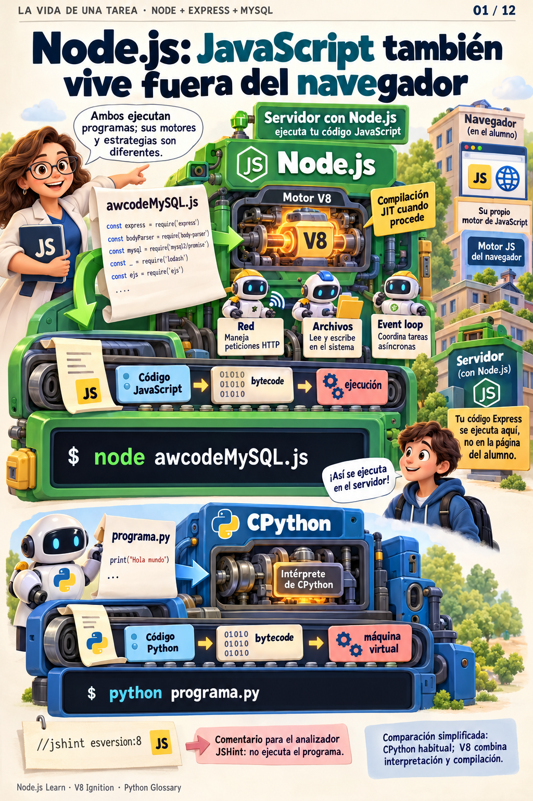

### 🔬 Anatomía y Fundamentos
Tradicionalmente, **JavaScript** nació y vivió confinado exclusivamente dentro del navegador web (Netscape, Firefox, Internet Explorer, Chrome). En ese entorno, JavaScript estaba fuertemente restringido por una "caja de arena" (*Sandbox*): no podía leer archivos del disco duro ni abrir conexiones TCP arbitrarias por razones de seguridad.

En 2009, Ryan Dahl tomó el motor **V8** de Google Chrome (creado en C++ para compilar JavaScript directamente a código máquina nativo) y lo unió a **libuv** (una librería multiplataforma para operaciones asíncronas de entrada/salida). El resultado fue **Node.js**: un entorno de ejecución (*runtime*) que permite ejecutar JavaScript en cualquier ordenador o servidor backend.

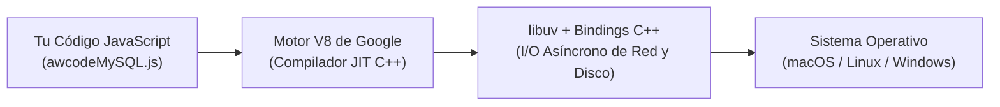

### 💡 ¿Qué aporta Node.js a nuestro proyecto?
- **Acceso al sistema de archivos y red:** Puede abrir un puerto TCP (`app.listen(3000)`) para escuchar peticiones de usuarios de todo el mundo.
- **Acceso a variables de entorno:** Podemos leer contraseñas y puertos de forma segura mediante `process.env.PORT` o `process.env.DB_PASSWORD`.
- **Conexión a bases de datos:** Abre sockets de red para comunicarse directamente con el servidor de MySQL en el puerto `3306`.

---

## 📌 Lámina 02: npm trae las herramientas; `require` las carga

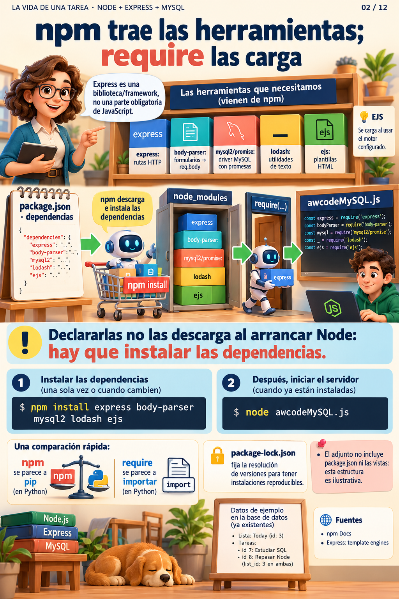

### 🔬 Anatomía y Fundamentos
El éxito de Node.js se debe en gran medida a **npm (Node Package Manager)**, el registro de código abierto más grande del mundo.

Existen dos momentos claramente diferenciados:
1. **Tiempo de Instalación (Terminal):** `npm install express mysql2 ...`  
   npm consulta los servidores centrales, descarga los paquetes con sus dependencias recursivas y los deposita en la carpeta local `node_modules/`, registrándolos en `package.json` y fijando sus versiones exactas en `package-lock.json`.
2. **Tiempo de Ejecución (Código JS):** `const express = require("express");`  
   El motor de Node busca el módulo dentro de `node_modules/`, ejecuta su código una sola vez, lo cachea en memoria y nos devuelve el objeto o función exportada (*CommonJS module system*).

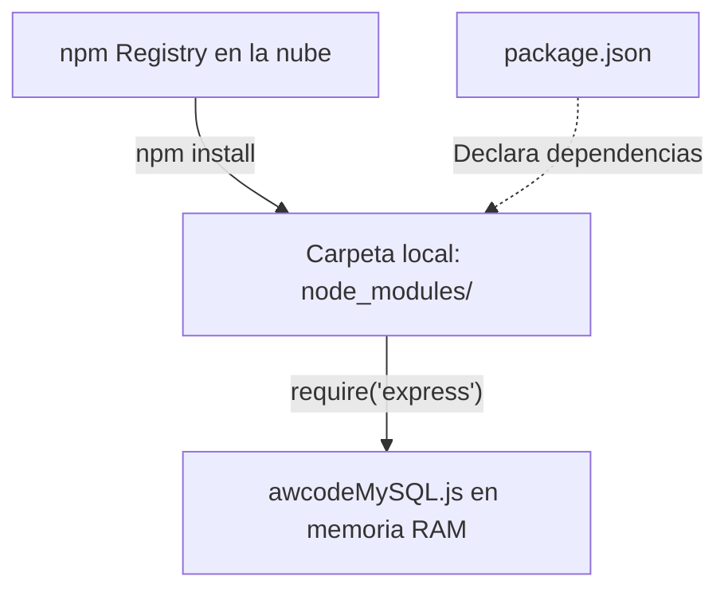

### 🧩 Las piezas clave de nuestra aplicación:
| Módulo | Tipo | Misión en la App |
| :--- | :--- | :--- |
| **`express`** | Framework Web | Enruta las peticiones HTTP (`GET`, `POST`), gestiona cabeceras y orquesta middlewares. |
| **`body-parser`** | Middleware | Intercepta las peticiones de formularios HTML y convierte el texto codificado en un objeto `req.body`. |
| **`mysql2/promise`** | Driver de BD | Traduce consultas SQL a paquetes binarios TCP y devuelve los resultados en `Promises` (`async/await`). |
| **`lodash` (`_`)** | Utilidades | Normaliza los nombres de las listas personalizadas con `_.capitalize("trabajo")` $\rightarrow$ `"Trabajo"`. |
| **`ejs`** | Motor de Vistas | Inyecta las variables de Node dentro de la plantilla HTML antes de enviarla al cliente. |

---

## 📌 Lámina 03: Arquitectura a Tres Capas (Navegador, Servidor y Base de Datos)


### 🔬 Anatomía y Fundamentos
Nuestra aplicación sigue el patrón clásico de **Arquitectura a Tres Capas (3-Tier Architecture)**. Cada capa tiene una responsabilidad única y aislada, comunicándose mediante protocolos de red estandarizados:

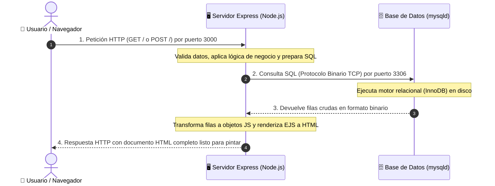

> [!IMPORTANT]
> **El navegador NUNCA se comunica directamente con MySQL.**  
> Si el navegador tuviera conexión directa con la base de datos, cualquier usuario podría inspeccionar el código, extraer la contraseña de `root` y ejecutar `DROP DATABASE`. El servidor Express actúa como un **guardián y árbitro de seguridad**.

---

## 📌 Lámina 04: Arranque e Inicialización DDL en MySQL

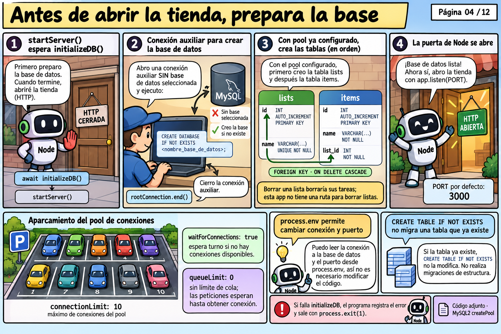

### 🔬 Anatomía y Fundamentos
Antes de que el servidor empiece a recibir peticiones de usuarios en el puerto `3000`, debe garantizar que la infraestructura de persistencia existe y está sana.

### 1. Connection Pool (Pool de Conexiones)
Crear una conexión TCP contra una base de datos requiere un costoso intercambio de paquetes (*3-Way Handshake* + autenticación criptográfica).  
En lugar de abrir y destruir una conexión por cada petición HTTP, `mysql.createPool()` crea una **reserva de conexiones vivas y reciclables**:

```javascript
const pool = mysql.createPool({
    host: "localhost",
    user: "root",
    password: "Pepito123",
    database: "todolistDB",
    waitForConnections: true,
    connectionLimit: 10 // Hasta 10 conexiones simultáneas reutilizables
});
```

### 2. DDL Condicional (Data Definition Language)
Nuestra función `initializeDB()` asegura de forma idempotente que tanto la base de datos como las tablas existen sin riesgo de errores de arranque:

```sql
-- 1. Asegurar la Base de Datos
CREATE DATABASE IF NOT EXISTS `todolistDB`;

-- 2. Tabla 'lists' (Padre)
CREATE TABLE IF NOT EXISTS lists (
    id INT AUTO_INCREMENT PRIMARY KEY,
    name VARCHAR(255) UNIQUE NOT NULL
);

-- 3. Tabla 'items' (Hija con Clave Foránea)
CREATE TABLE IF NOT EXISTS items (
    id INT AUTO_INCREMENT PRIMARY KEY,
    name VARCHAR(255) NOT NULL,
    list_id INT NOT NULL,
    FOREIGN KEY (list_id) REFERENCES lists(id) ON DELETE CASCADE
);
```

> [!TIP]
> `ON DELETE CASCADE` es una regla de integridad referencial fundamental: si en el futuro borras una lista completa de la tabla `lists`, MySQL eliminará automáticamente todas sus tareas hijas de `items` sin dejar registros huérfanos.

---

## 📌 Lámina 05: GET / — Encontrar "Today" y preparar sus tareas

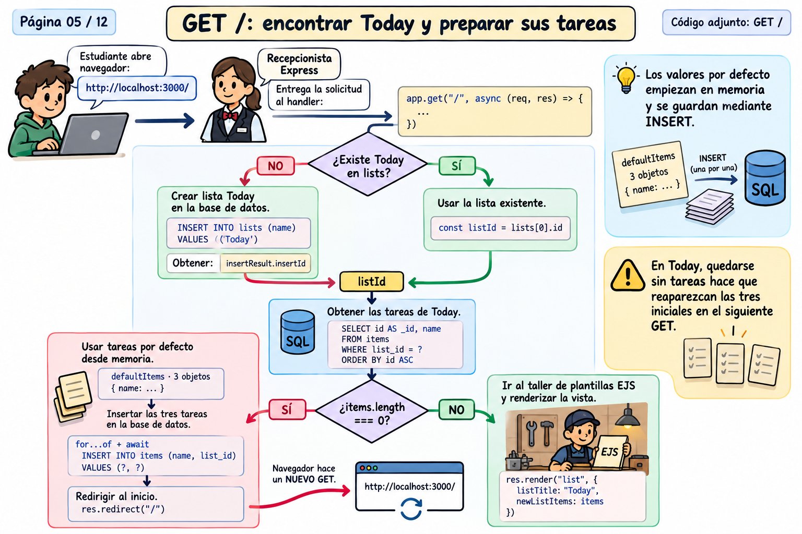

### 🔬 Anatomía y Fundamentos
Cuando el usuario entra a `http://localhost:3000/`, se dispara el controlador de la ruta principal. Este implementa la estrategia de **Sembrado Perezoso (Lazy Seeding)**:

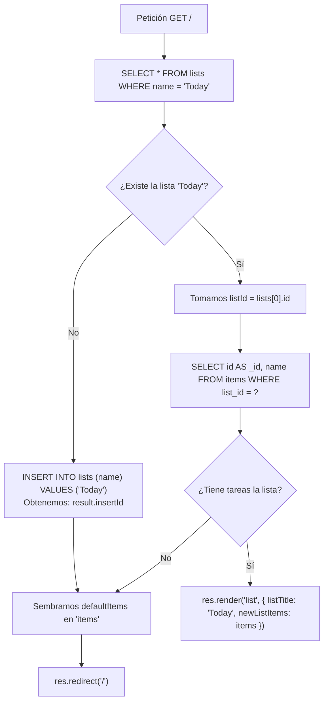

### El detalle docente de `id AS _id`:
En SQL el estándar de clave primaria es `id`. Sin embargo, la plantilla EJS original venía programada para MongoDB (donde la clave se llama `_id`).  
Al escribir:
```sql
SELECT id AS _id, name FROM items WHERE list_id = ? ORDER BY id ASC;
```
Le decimos a MySQL que renombre al vuelo el campo en el resultado, logrando que el HTML/EJS funcione al 100% sin tener que reescribir la vista.

---

## 📌 Lámina 06: Del SELECT a Objetos JavaScript con `mysql2`

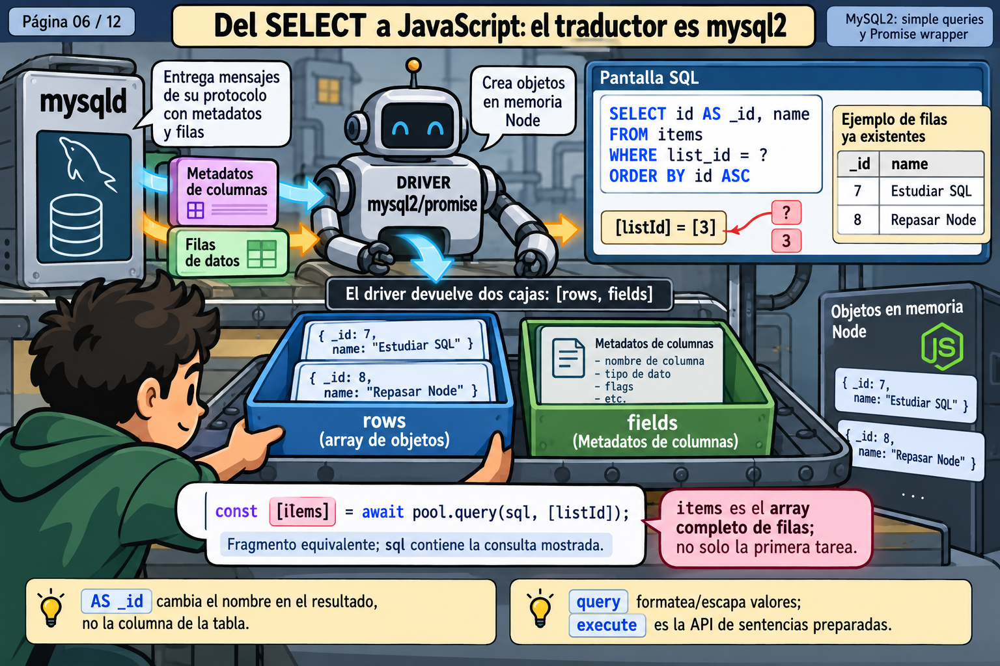

### 🔬 Anatomía y Fundamentos
¿Qué ocurre exactamente cuando se ejecuta `await pool.query(...)`?

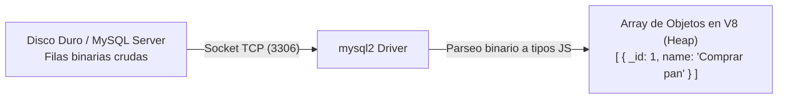

1. **En MySQL:** El motor InnoDB lee los bloques de datos del disco y empaqueta las columnas en tramas binarias TCP.
2. **En el Driver `mysql2`:** El conector deserializa la trama:
   - Un `INT` de MySQL se transforma en un primitivo `Number` de JavaScript.
   - Un `VARCHAR` se transforma en un `String` UTF-8.
3. **Desestructuración de Tupla:** `mysql2/promise` devuelve un array de dos elementos: `[rows, fields]`.
   ```javascript
   const [items] = await pool.query("SELECT id AS _id, name FROM items WHERE list_id = ?", [listId]);
   // 'items' contiene directamente el array de filas de la tabla
   ```

---

## 📌 Lámina 07: Objetos JavaScript en Memoria vs Texto JSON

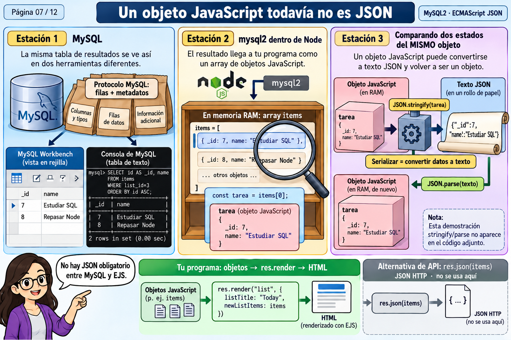

### 🔬 Anatomía y Fundamentos
Uno de los conceptos más confundidos por los alumnos de desarrollo web es la diferencia entre un **Objeto JavaScript** y una cadena **JSON**.

| Característica | Objeto JavaScript (En Memoria) | Texto JSON (Transmisión) |
| :--- | :--- | :--- |
| **Naturaleza** | Estructura de datos viva en la memoria RAM del proceso Node. | Cadena de texto plano (`string`) con formato estricto. |
| **Claves** | Pueden ir sin comillas: `{ name: "Comprar pan" }`. | **Obligatoriamente** con comillas dobles: `{"name": "Comprar pan"}`. |
| **Tipos admitidos** | Funciones, Fechas (`Date`), `undefined`, símbolos, referencias circulares. | Solo valores primitivos básicos: cadenas, números, booleanos, arrays y null. |
| **Propósito** | Manipulación y cálculo directo por el procesador. | Intercambio de datos entre máquinas a través de la red (HTTP). |

```javascript
// Objeto vivo en memoria RAM:
const item = { _id: 1, name: "Comprar pan" };

// Serialización a texto plano JSON:
const textoJson = JSON.stringify(item); 
// Resultado: '{"_id":1,"name":"Comprar pan"}'

// Deserialización de vuelta a memoria:
const objetoRestaurado = JSON.parse(textoJson);
```

---

## 📌 Lámina 08: EJS — Motor de Plantillas y Server-Side Rendering (SSR)

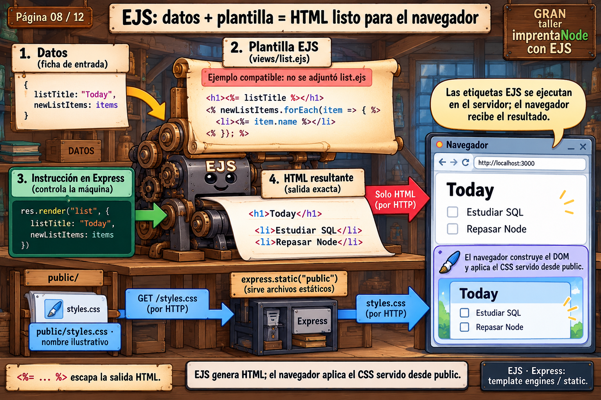

### 🔬 Anatomía y Fundamentos
Nuestra aplicación utiliza **Server-Side Rendering (SSR)** mediante el motor de plantillas **EJS (Embedded JavaScript)**:

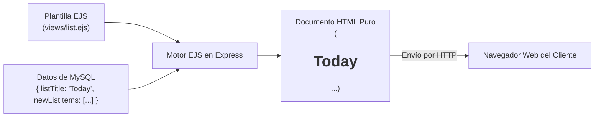

### La Sintaxis Mágica de EJS:
- `<% %>` **Scriptlet (Lógica pura):** Ejecuta código JavaScript en el servidor sin pintar nada en el HTML. Se usa para bucles y condicionales:
  ```ejs
  <% newListItems.forEach(function(item){ %>
  ```
- `<%= %>` **Interpolación con Escapado Seguro:** Evalúa la variable y la imprime en el documento, convirtiendo automáticamente caracteres peligrosos (como `<` o `>`) en entidades HTML (`&lt;`, `&gt;`) para **proteger la web contra ataques XSS (Cross-Site Scripting)**:
  ```ejs
  <p><%= item.name %></p>
  ```
- `<%- %>` **Salida Raw (Sin escapar):** Imprime contenido HTML crudo. Esencial para modularizar vistas con encabezados y pies de página compartidos:
  ```ejs
  <%- include("header") -%>
  ```

---

## 📌 Lámina 09: Añadir Tarea: Formulario POST, INSERT y Patrón PRG

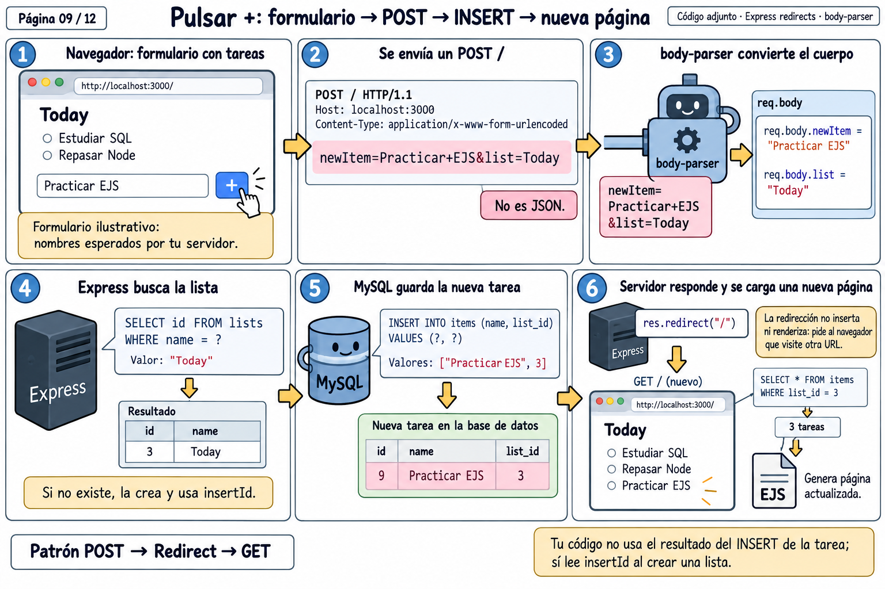

### 🔬 Anatomía y Fundamentos
Cuando el usuario escribe `"Estudiar SQL"` y presiona el botón `+`:

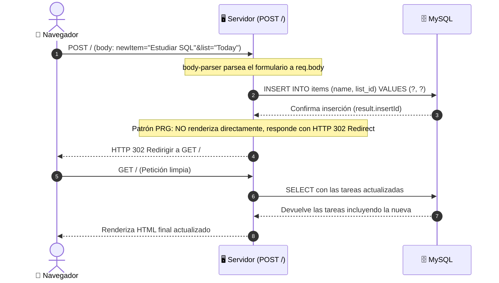

### 🛡️ Prevención de Inyección SQL con Consultas Preparadas
Fíjate en cómo guardamos la tarea:
```javascript
// ✅ SEGURO: Parámetros posicionales con '?'
await pool.query("INSERT INTO items (name, list_id) VALUES (?, ?)", [itemName, listId]);

// ❌ VULNERABLE A SQL INJECTION (NUNCA HACER):
// await pool.query(`INSERT INTO items (name) VALUES ('${itemName}')`);
```
Al usar `?`, el driver `mysql2` envía la sentencia SQL y los datos por canales separados, neutralizando cualquier intento de inyección de código malicioso.

### 🔄 El Patrón PRG (Post-Redirect-Get)
Si tras un `POST` el servidor respondiera inmediatamente con `res.render()`, al pulsar el usuario la tecla **F5 / Refrescar**, el navegador volvería a enviar el formulario, duplicando la tarea una y otra vez.  
La redirección `res.redirect("/")` convierte la navegación final en una petición `GET` inocua y segura.

---

## 📌 Lámina 10: Borrar una Tarea por su ID


### 🔬 Anatomía y Fundamentos
En las listas de tareas modernas es deseable que al marcar un *checkbox* la tarea se elimine de inmediato sin requerir un botón adicional de "Eliminar".

### El truco del Checkbox auto-enviado:
```html
<form action="/delete" method="post">
  <input type="checkbox" name="checkbox" value="<%= item._id %>" onChange="this.form.submit()">
  <p><%= item.name %></p>
  <input type="hidden" name="listName" value="<%= listTitle %>"></input>
</form>
```
1. Cada tarea está contenida en su propio `<form>`.
2. El atributo `value` del checkbox transporta el ID numérico único de la tarea en MySQL.
3. El evento JavaScript del navegador `onChange="this.form.submit()"` detecta el clic y envía el formulario de forma transparente al servidor.
4. El campo `<input type="hidden">` viaja silenciosamente con el nombre de la lista actual, de modo que si estás borrando una tarea de la lista `"Trabajo"`, el servidor sabe que debe redirigirte a `/Trabajo` y no a la raíz.

En el backend, el borrado es instantáneo gracias al índice de clave primaria:
```javascript
await pool.query("DELETE FROM items WHERE id = ?", [checkedItemId]);
```

---

## 📌 Lámina 11: Listas Personalizadas y la Regla de Oro del Enrutamiento


### 🔬 Anatomía y Fundamentos
Express permite declarar **rutas parametrizadas dinámicas** mediante el prefijo de dos puntos (`:parametro`):

```javascript
app.get("/:customListName", async (req, res) => {
    // Si el usuario visita /trabajo -> req.params.customListName vale "trabajo"
    const customListName = _.capitalize(req.params.customListName); // "Trabajo"
    // Busca o crea la lista "Trabajo" y renderiza sus tareas específicas
});
```

### ⚠️ La Regla de Oro del Embudo de Rutas:
Express evalúa las rutas **estrictamente de arriba a abajo**. Una ruta con parámetro comodín como `/:customListName` atrapará **cualquier** palabra que vaya detrás del dominio.

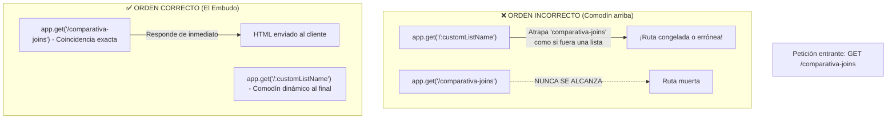

> **Regla de oro:** Las rutas estáticas y específicas (`/`, `/comparativa-joins`, `/about`) **deben declararse SIEMPRE antes** que las rutas con parámetros dinámicos (`/:customListName`).

---

## 📌 Lámina 12: `async/await`, el Event Loop y el Viaje Completo

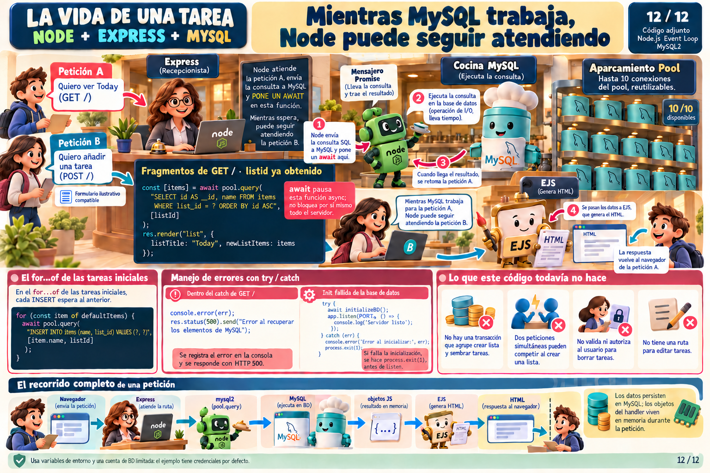

### 🔬 Anatomía y Fundamentos
Node.js se ejecuta sobre un **único hilo principal (Single Thread)**. Si una consulta a la base de datos tardara 50 milisegundos y bloqueara el hilo, ningún otro usuario en el mundo podría interactuar con nuestra aplicación mientras tanto.

Aquí es donde entra la magia de **`async/await`** y el **Event Loop**:

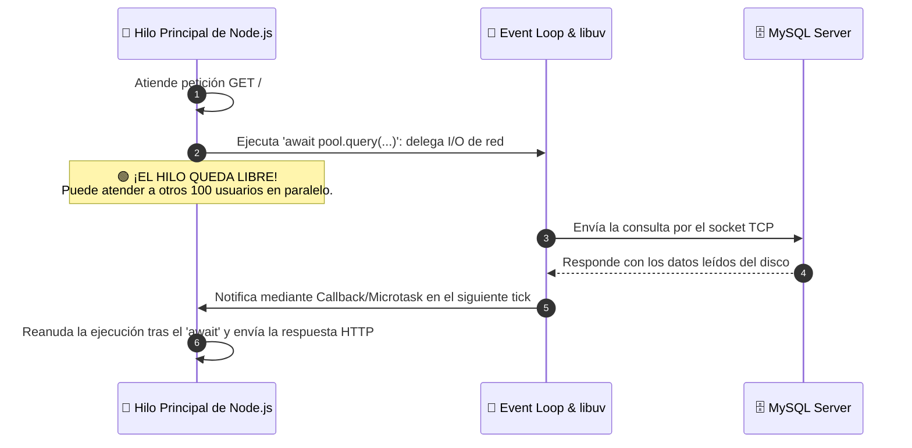

### ¿Qué hace `await` bajo el capó?
No "duerme" ni congela tu ordenador. Simplemente pausa la ejecución de esa función concreta, guarda su estado en memoria y **libera el hilo de Node.js** para que siga respondiendo a otras peticiones. Cuando el socket de MySQL devuelve los datos, el Event Loop reactiva la función donde se quedó y continúa con el renderizado.

---

## 🎯 Conclusión del Viaje: La Vida de una Tarea

A través de estas 12 láminas hemos presenciado el ciclo completo de la ingeniería web moderna:

1. **El Entorno:** Node.js sacó a JavaScript de las limitaciones del navegador.
2. **El Ecosistema:** npm y `require` modularizaron la aplicación con herramientas robustas.
3. **La Red:** La arquitectura a 3 capas protegió la base de datos mediante un backend intermediario.
4. **La Persistencia:** MySQL y su pool de conexiones garantizaron almacenamiento relacional duradero y seguro.
5. **La Interfaz:** EJS transformó datos relacionales en interfaces HTML interactivas con Server-Side Rendering.
6. **El Rendimiento:** `async/await` permitió atender a múltiples usuarios concurrentes sin esperas bloqueantes.

