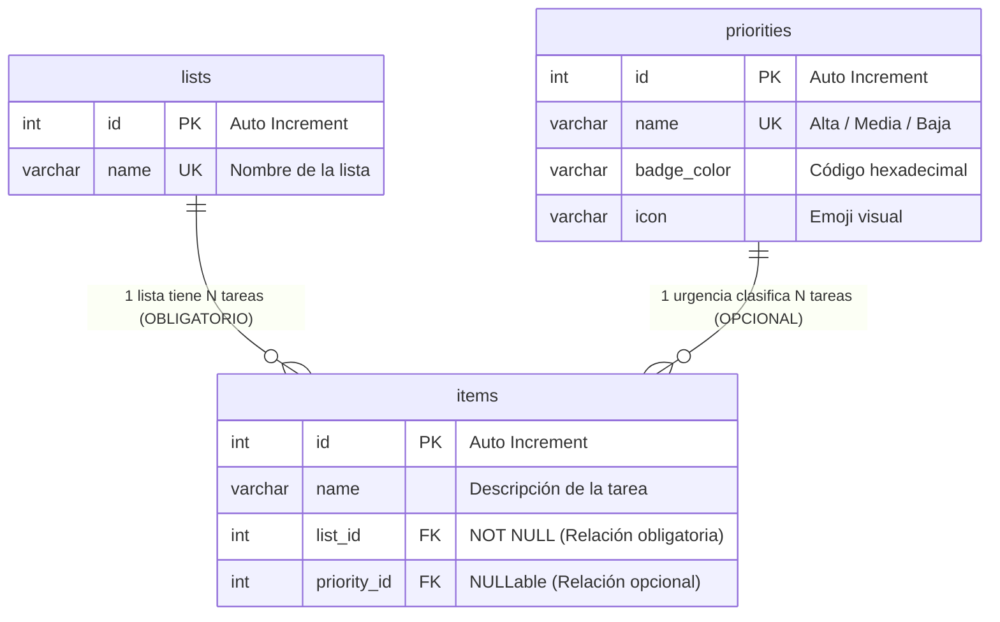
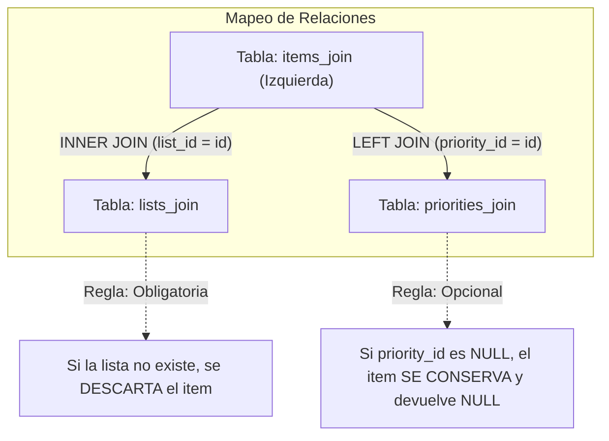

# 🧪 Laboratorio Didáctico: Dominando `INNER JOIN` y `LEFT JOIN` en SQL con Node.js y Express

Este documento es una guía formativa y práctica diseñada para que los alumnos comprendan **cuándo, cómo y por qué** se utilizan las operaciones relacionales de combinación de tablas (`INNER JOIN` y `LEFT JOIN`) en un caso de uso real.

---

## 🎯 1. Objetivos Pedagógicos

Al finalizar este laboratorio, el estudiante será capaz de:
1. Entender la diferencia teórica y de cardinalidad entre un `INNER JOIN` y un `LEFT JOIN`.
2. Identificar el **riesgo de pérdida de información** al usar `INNER JOIN` sobre campos opcionales (`NULLables`).
3. Modelar una relación relacional `1:N` obligatoria y una `1:N` opcional en MySQL.
4. Construir consultas preparadas combinando múltiples `JOIN` en Node.js con `mysql2/promise`.

---

## 📐 2. El Modelo Relacional (3 Tablas)

Para este ejercicio ampliamos el esquema tradicional de la aplicación de tareas a tres entidades interconectadas:



### Definición DDL en MySQL (Tablas Aisladas):
```sql
-- 1. Tabla de Listas
CREATE TABLE IF NOT EXISTS lists_join (
    id INT AUTO_INCREMENT PRIMARY KEY,
    name VARCHAR(255) UNIQUE NOT NULL
);

-- 2. Catálogo maestro de Prioridades/Urgencias
CREATE TABLE IF NOT EXISTS priorities_join (
    id INT AUTO_INCREMENT PRIMARY KEY,
    name VARCHAR(50) UNIQUE NOT NULL,
    badge_color VARCHAR(20) NOT NULL,
    icon VARCHAR(10) NOT NULL
);

-- 3. Tabla de Tareas (Items)
CREATE TABLE IF NOT EXISTS items_join (
    id INT AUTO_INCREMENT PRIMARY KEY,
    name VARCHAR(255) NOT NULL,
    list_id INT NOT NULL,
    priority_id INT NULL,
    FOREIGN KEY (list_id) REFERENCES lists_join(id) ON DELETE CASCADE,
    FOREIGN KEY (priority_id) REFERENCES priorities_join(id) ON DELETE SET NULL
);
```

---

## 🔍 3. Análisis de la Consulta Maestra

En el archivo [`awcodeMySQLJoin.js`](file:///Users/fjbanezares/express-mongo-hands-on/awcodeMySQLJoin.js), la consulta que recupera la información para la vista principal combina ambas cláusulas:

```sql
SELECT 
    items_join.id AS _id,
    items_join.name AS name,
    lists_join.name AS list_name,
    priorities_join.name AS priority_name,
    priorities_join.badge_color AS priority_color,
    priorities_join.icon AS priority_icon
FROM items_join
INNER JOIN lists_join ON items_join.list_id = lists_join.id
LEFT JOIN priorities_join ON items_join.priority_id = priorities_join.id
WHERE lists_join.name = ?
ORDER BY items_join.id ASC;
```



### ¿Por qué `INNER JOIN lists_join`?
La relación es **estricta**. Una tarea no puede ser huérfana; debe pertenecer a una lista válida (`list_id NOT NULL`). El `INNER JOIN` garantiza que solo se consulten tareas que pertenezcan a la lista actual.

### ¿Por qué `LEFT JOIN priorities_join`?
La asignación de una urgencia es **voluntaria** (`priority_id NULL`).
- **El error clásico del alumno:** Escribir `INNER JOIN priorities_join`. Al hacer esto, **todas las tareas sin urgencia desaparecen del resultado**, ya que no existe coincidencia en la tabla `priorities_join`.
- **La solución con `LEFT JOIN`:** Garantiza que se muestren **todas** las filas de la tabla de la izquierda (`items_join`), rellenando los atributos de prioridad con `NULL` cuando la tarea no tenga urgencia.

---

## 🧪 4. El Laboratorio Didáctico en Vivo (`/comparativa-joins`)

Para evidenciar este comportamiento sin necesidad de abrir la consola de MySQL, el servidor incluye una ruta educativa especial:

> **URL de prueba:** [http://localhost:3000/comparativa-joins](http://localhost:3000/comparativa-joins)

Esta vista ejecuta ambas consultas sobre los mismos datos en tiempo real y muestra el resultado en dos columnas:

| Aspecto | `INNER JOIN priorities` | `LEFT JOIN priorities` (Correcto) |
| :--- | :--- | :--- |
| **Tareas mostradas** | Solo aquellas con urgencia asignada | **Todas** las tareas de la lista |
| **Tareas sin urgencia** | ❌ **Ocultadas / Perdidas** | ✅ Mostradas con valor `NULL` |
| **Cardinalidad devuelta** | Menor o igual al total de tareas | **Exactamente igual** al total de tareas |

---

## 🚀 5. Puesta en Marcha del Ejercicio

1. Asegúrate de tener MySQL iniciado en tu sistema:
   ```bash
   sudo /usr/local/mysql/support-files/mysql.server status
   ```
2. Arranca el ejercicio mediante el script dedicado:
   ```bash
   npm run start:mysql:join
   ```
3. Visita [http://localhost:3000](http://localhost:3000):
   - Añade una tarea con urgencia 🔴 **Alta**.
   - Añade otra tarea con ⚪ **Sin urgencia**.
   - Observa cómo ambas se renderizan y la urgente luce su distintivo visual.
4. Visita [http://localhost:3000/comparativa-joins](http://localhost:3000/comparativa-joins) para ver la comparativa didáctica.

---

## 🎓 6. Propuestas de Retos y Ejercicios para los Alumnos

A continuación se plantean 3 ampliaciones progresivas para que los alumnos practiquen distintos tipos de `JOIN` y conceptos avanzados de modelado relacional.

---

### 📌 Reto 1: Asignación de Miembros del Equipo y `RIGHT JOIN`

**Objetivo didáctico:** Comprender el uso de `RIGHT JOIN` o `LEFT JOIN` invertido para detectar recursos sin asignación.

**Planteamiento:**
Crear una tabla `users` (miembros del equipo) y permitir que una tarea sea asignada a un usuario. En un panel de supervisión, el alumno debe responder a la pregunta: *"¿Qué miembros del equipo NO tienen ninguna tarea asignada?"*.

#### Cambios en la Base de Datos (DDL):
```sql
CREATE TABLE IF NOT EXISTS users (
    id INT AUTO_INCREMENT PRIMARY KEY,
    name VARCHAR(100) NOT NULL,
    avatar_emoji VARCHAR(10) NOT NULL
);

-- Modificar items para añadir el usuario asignado
ALTER TABLE items ADD COLUMN assigned_user_id INT NULL;
ALTER TABLE items ADD CONSTRAINT fk_user 
    FOREIGN KEY (assigned_user_id) REFERENCES users(id) ON DELETE SET NULL;
```

#### Pseudocódigo / Cambios en Node.js:
```javascript
// Ruta: GET /equipo-carga
app.get("/equipo-carga", async (req, res) => {
    // RIGHT JOIN: Conserva TODOS los usuarios, aunque no tengan tareas en la tabla items
    const query = `
        SELECT 
            users.id AS user_id,
            users.name AS user_name,
            users.avatar_emoji,
            items.name AS task_name
        FROM items
        RIGHT JOIN users ON items.assigned_user_id = users.id
        ORDER BY users.name ASC;
    `;
    const [rows] = await pool.query(query);
    res.render("team_workload", { workload: rows });
});
```

---

### 📌 Reto 2: Etiquetas Múltiples (Relación N:M y Doble `LEFT JOIN`)

**Objetivo didáctico:** Dominar la combinación de relaciones Muchos a Muchos ($N:M$) con tabla pivote (intermedia) y agregación con `GROUP_CONCAT`.

**Planteamiento:**
Una tarea puede tener múltiples etiquetas (ej: `#Backend`, `#Urgente`, `#Diseño`). Una etiqueta puede estar en muchas tareas.

```mermaid
erDiagram
    items ||--o{ item_tags : "1 tarea tiene muchos vínculos"
    tags ||--o{ item_tags : "1 etiqueta tiene muchos vínculos"

    items { int id PK }
    tags { int id PK, varchar label, varchar color }
    item_tags { int item_id FK, int tag_id FK }
```

#### Cambios en la Base de Datos (DDL):
```sql
CREATE TABLE tags (
    id INT AUTO_INCREMENT PRIMARY KEY,
    label VARCHAR(50) UNIQUE NOT NULL,
    color VARCHAR(20) DEFAULT '#777'
);

CREATE TABLE item_tags (
    item_id INT NOT NULL,
    tag_id INT NOT NULL,
    PRIMARY KEY (item_id, tag_id),
    FOREIGN KEY (item_id) REFERENCES items(id) ON DELETE CASCADE,
    FOREIGN KEY (tag_id) REFERENCES tags(id) ON DELETE CASCADE
);
```

#### Pseudocódigo / Consulta SQL con Doble `LEFT JOIN`:
```javascript
// Consulta maestra que agrupa todas las etiquetas de cada tarea en un string separado por comas
const query = `
    SELECT 
        items.id AS _id,
        items.name AS name,
        GROUP_CONCAT(tags.label SEPARATOR ', ') AS tags_list
    FROM items
    LEFT JOIN item_tags ON items.id = item_tags.item_id
    LEFT JOIN tags ON item_tags.tag_id = tags.id
    GROUP BY items.id
    ORDER BY items.id ASC;
`;
```
> **Lección clave para el alumno:** Si una tarea no tiene etiquetas, gracias al `LEFT JOIN` doble la tarea sigue apareciendo y `tags_list` resulta `NULL`.

---

### 📌 Reto 3: Panel de Métricas con `LEFT JOIN` y `COUNT` vs `COUNT(*)`

**Objetivo didáctico:** Comprender la sutil pero crítica diferencia entre `COUNT(*)` y `COUNT(columna)` cuando se combina con `LEFT JOIN` y `GROUP BY`.

**Planteamiento:**
Crear una página de resumen (`/dashboard`) que liste todas las listas existentes en el sistema y el número total de tareas que tiene cada una.

#### La Trampa Didáctica:
```sql
-- ❌ ERROR COMÚN DEL ALUMNO:
SELECT lists.name, COUNT(*) AS total
FROM lists
LEFT JOIN items ON lists.id = items.list_id
GROUP BY lists.id;
-- PROBLEMA: Una lista vacía sin tareas devuelve 1 (porque cuenta la fila con valores NULL generada por el LEFT JOIN).

-- ✅ SOLUCIÓN CORRECTA:
SELECT lists.name, COUNT(items.id) AS total_tareas
FROM lists
LEFT JOIN items ON lists.id = items.list_id
GROUP BY lists.id;
-- SOLUCIÓN: COUNT(items.id) ignora los valores NULL y devuelve correctamente 0 si la lista no tiene tareas.
```

#### Pseudocódigo en Node.js:
```javascript
app.get("/dashboard", async (req, res) => {
    const query = `
        SELECT 
            lists.name AS list_title,
            COUNT(items.id) AS total_items,
            SUM(CASE WHEN items.priority_id = 1 THEN 1 ELSE 0 END) AS total_altas
        FROM lists
        LEFT JOIN items ON lists.id = items.list_id
        GROUP BY lists.id
        ORDER BY total_items DESC;
    `;
    const [stats] = await pool.query(query);
    res.json(stats);
});
```

---

## 🏆 7. Resumen de Criterios de Evaluación para Alumnos

| Criterio | Nivel Básico | Nivel Avanzado |
| :--- | :--- | :--- |
| **Sintaxis de JOIN** | Escribe consultas `JOIN` con la cláusula `ON` correcta. | Sabe encadenar múltiples `INNER` y `LEFT JOIN` en una sola sentencia. |
| **Selección del tipo de JOIN** | Utiliza `INNER JOIN` por defecto sin evaluar nulabilidad. | Discierne cuándo usar `LEFT JOIN` para campos opcionales sin perder registros. |
| **Manejo de Nulos (`NULL`)** | Maneja errores cuando los campos foráneos son nulos. | Emplea funciones como `COALESCE()` o `IFNULL()` para sustituir nulos en la vista. |
| **Agregación con JOIN** | Usa `COUNT(*)` desconociendo el efecto sobre los nulos. | Emplea `COUNT(columna_fk)` para evitar contar falsos positivos en listas vacías. |

