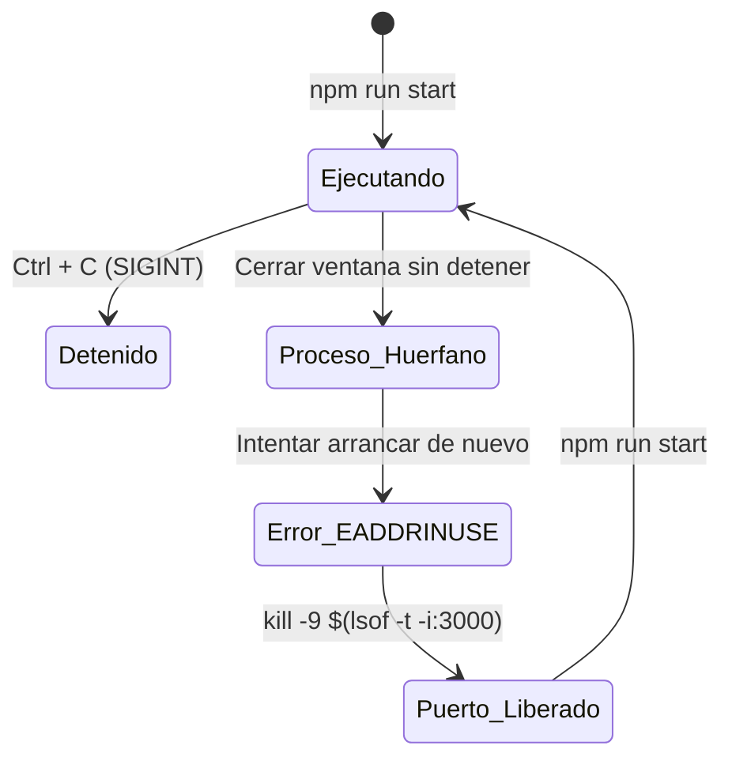
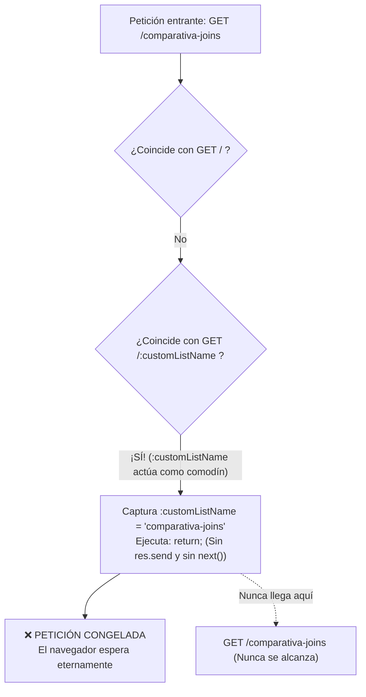

# 🛠️ Guía Didáctica: Ciclo de Vida de Node.js, Gestión de Puertos y Enrutamiento en Express

Esta guía explica en detalle dos aspectos esenciales para desarrolladores de Node.js y Express:
1. **Cómo controlar el ciclo de vida del servidor Node** (detener, reiniciar, liberar puertos ocupados y usar `nodemon`).
2. **Por qué una ruta de Express puede "quedarse muerta/congelada"** (la regla de oro del orden de los middlewares y rutas dinámicas con `:parametro`).

---

## 🔄 Parte 1: Ciclo de Vida del Servidor Node.js

Cuando ejecutas un servidor Express con `node app.js`, Node inicia un proceso continuo controlado por el **Event Loop**. A diferencia de un script que termina tras ejecutarse, el servidor se queda a la escucha permanente en un puerto TCP (por ejemplo, el `3000`).



### 1. Cómo detener el servidor normalmente
En la pestaña de la terminal donde está ejecutándose el servidor, presiona:
```text
Ctrl + C
```
> [!NOTE]
> En macOS es la tecla **Control** (⌃), **no** la tecla Command (⌘). Esta combinación envía la señal `SIGINT` (Signal Interrupt) al proceso de Node, permitiéndole cerrar los sockets y apagarse limpiamente.

---

### 2. El Error Frecuente: `EADDRINUSE: address already in use :::3000`
Si cierras la terminal sin pulsar `Ctrl + C`, o si el proceso se cuelga en segundo plano, el sistema operativo mantendrá el puerto `3000` bloqueado por ese proceso. Al intentar arrancar de nuevo, verás:

```text
Error: listen EADDRINUSE: address already in use :::3000
```

#### Solución en macOS/Linux en 2 pasos:
1. **Averiguar qué proceso tiene ocupado el puerto 3000:**
   ```bash
   lsof -i :3000
   ```
   *(Verás una columna llamada `PID` con el número del proceso).*

2. **Matar el proceso forzosamente:**
   ```bash
   kill -9 <PID>
   ```

#### Comando rápido en una sola línea:
```bash
kill -9 $(lsof -t -i:3000)
```
*(El modificador `-t` devuelve únicamente el número de PID, que pasa directamente como argumento a `kill -9`).*

---

### 3. Buenas Prácticas: Reinicio automático con `nodemon`
Para evitar tener que parar y volver a arrancar manualmente cada vez que haces cambios en tu código JavaScript:

```bash
npx nodemon awcodeMySQLJoin.js
```
`nodemon` vigila los archivos de tu proyecto; en cuanto detecta que guardas un archivo (`Cmd + S`), reinicia el proceso de Node en milisegundos de forma transparente.

---

## 🚦 Parte 2: ¿Por qué una ruta de Express "se queda muerta"?

Uno de los problemas más desconcertantes en Express ocurre cuando visitas una URL en el navegador (por ejemplo, `http://localhost:3000/comparativa-joins`) y el icono de carga gira indefinidamente sin mostrar nada.

### La Causa Raíz: El orden de definición en Express
Express evalúa las rutas **estrictamente de arriba hacia abajo**, en el orden exacto en el que fueron escritas con `app.get()`.



### El Escenario del Error:
Observa el código problemático:

```javascript
// ❌ ERROR: Ruta con parámetro comodín colocada ANTES de la ruta estática
app.get("/:customListName", (req, res) => {
    // Si la ruta solicitada es 'comparativa-joins', salimos
    if (req.params.customListName === "comparativa-joins") return; 
    
    // ... buscar en la base de datos y renderizar ...
});

// Esta ruta NUNCA se llegaba a ejecutar
app.get("/comparativa-joins", (req, res) => {
    res.send("HTML de la comparativa");
});
```

#### ¿Por qué se quedaba congelado?
1. El parámetro `/:customListName` es un **comodín (wildcard)**. Coincide con **cualquier** palabra que vaya detrás de la barra (`/trabajo`, `/compras` o `/comparativa-joins`).
2. Express entró en la función de `/:customListName`.
3. La línea `if (req.params.customListName === "comparativa-joins") return;` simplemente hizo un `return` de JavaScript.
4. **No envió una respuesta (`res.send()`, `res.render()`) ni delegó al siguiente middleware (`next()`)**.
5. Como el socket HTTP quedó abierto sin respuesta, el navegador se queda esperando hasta que salta un *Timeout*.

---

### La Solución: La Regla de Oro del Enrutamiento

> **REGLA DE ORO EN EXPRESS:**
> **Las rutas estáticas específicas SIEMPRE se declaran ANTES que las rutas dinámicas con comodines (`:parametro`).**

```javascript
// ✅ SOLUCIÓN CORRECTA:

// 1. Rutas fijas y específicas primero
app.get("/", (req, res) => { ... });
app.get("/comparativa-joins", (req, res) => { ... });
app.get("/about", (req, res) => { ... });

// 2. Rutas dinámicas con comodín SIEMPRE AL FINAL
app.get("/:customListName", (req, res) => {
    // Ahora :customListName solo recibirá nombres de listas reales
    // porque 'comparativa-joins' y 'about' ya fueron capturadas antes.
});
```

Al mover `app.get("/comparativa-joins", ...)` por encima de `app.get("/:customListName", ...)`, Express resuelve la ruta inmediatamente y responde al navegador al instante.

---

## 📋 Resumen Rápido para el Desarrollador

| Problema | Causa | Solución |
| :--- | :--- | :--- |
| El servidor no responde a cambios de código | Node mantiene el proceso en memoria | Detener con `Ctrl + C` y reiniciar, o usar `npx nodemon`. |
| `EADDRINUSE :::3000` | Un proceso anterior sigue vivo en segundo plano | Ejecutar `kill -9 $(lsof -t -i:3000)`. |
| La página web se queda cargando en bucle | Una ruta dinámica atrapó la petición y no llamó a `res.send()` ni `next()` | Reordenar las rutas: poner las fijas antes de las dinámicas con `:param`. |

