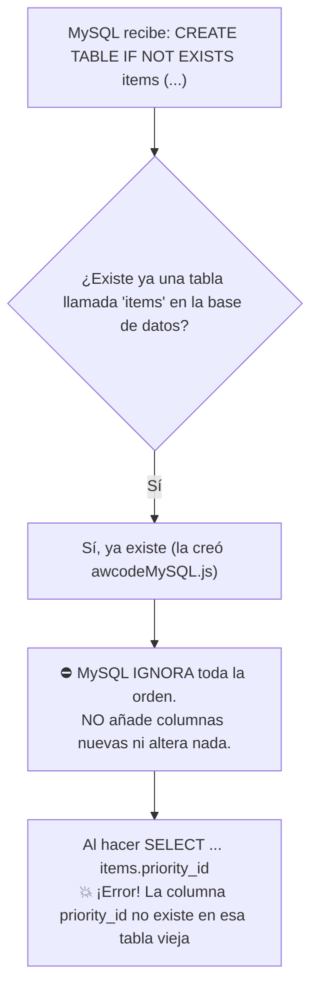
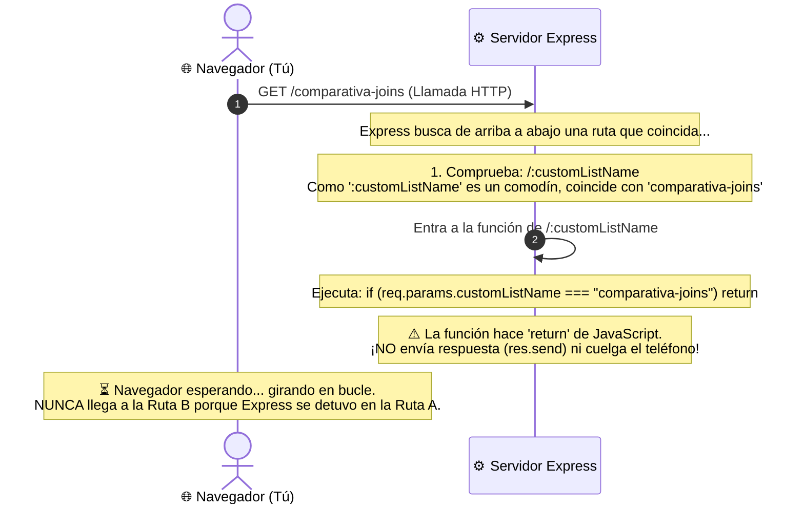
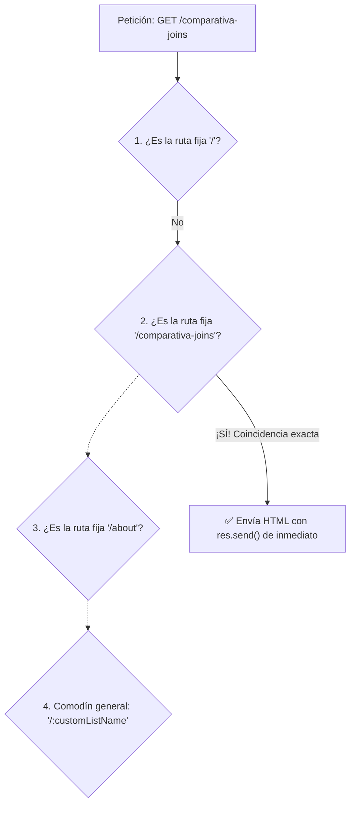

# 🎓 Guía Didáctica: ¿Qué falló y cómo lo solucionamos paso a paso?

Esta guía explica de forma muy visual y con analogías sencillas los **dos problemas reales** que nos encontramos, por qué sucedieron y exactamente cómo los resolvimos en el código.

---

## 🛑 CASO 1: El error de Base de Datos (`Unknown column 'items.priority_id'`)

### 1. La Historia: ¿Qué ocurrió?
1. Primero ejecutamos `awcodeMySQL.js`. Este script creó en la base de datos la tabla `items` con tres columnas:
   - `id`
   - `name`
   - `list_id`
2. Luego creamos `awcodeMySQLJoin.js` e intentamos ejecutar:
   ```sql
   CREATE TABLE IF NOT EXISTS items (
       id INT AUTO_INCREMENT PRIMARY KEY,
       name VARCHAR(255) NOT NULL,
       list_id INT NOT NULL,
       priority_id INT NULL   -- 👈 ¡NUEVA COLUMNA!
   );
   ```
3. Al arrancar la aplicación, MySQL lanzó este error en la consola:
   ```text
   ER_BAD_FIELD_ERROR: Unknown column 'items.priority_id' in 'on clause'
   ```

---

### 2. ¿Por qué ocurrió? La trampa de `IF NOT EXISTS`

La instrucción `CREATE TABLE IF NOT EXISTS` tiene una regla de funcionamiento fundamental:



> **Explicación didáctica:** MySQL vio que la tabla `items` ya existía en el disco duro, así que **ignoró por completo la orden**. Por tanto, la columna `priority_id` **nunca se llegó a crear**. Cuando la consulta de JOIN intentó buscar `items.priority_id`, MySQL dio un error porque no existía.

---

### 3. ¿Cómo lo solucionamos? (Aislamiento de Tablas)

En lugar de borrar la tabla anterior (lo que rompería el script `awcodeMySQL.js`), creamos **tablas independientes y aisladas con el sufijo `_join`**:

| Práctica Estándar (`awcodeMySQL.js`) | Práctica Avanzada (`awcodeMySQLJoin.js`) |
| :--- | :--- |
| `lists` | `lists_join` |
| `items` (sin prioridades) | `items_join` (con `priority_id`) |
| *(no tiene prioridades)* | `priorities_join` |

Al tener un nombre nuevo (`items_join`), MySQL detectó que **no existía**, creó la tabla desde cero con la columna `priority_id`, y el error desapareció.

---

## 🛑 CASO 2: La web se queda "congelada / muerta" al entrar a `/comparativa-joins`

### 1. La Analogía del Teléfono 📞

Una petición web (HTTP) entre tu navegador y tu servidor Node.js es exactamente igual que una **llamada telefónica**:

1. **Tu navegador marca el número:** *"Hola servidor, dame el contenido de `/comparativa-joins`"*.
2. El navegador se queda con el auricular en la oreja **esperando una respuesta** (por eso en la pestaña de Chrome sale el círculo girando).
3. El servidor debe responder con `res.send("HTML")` o `res.render("vista")` y colgar.

---

### 2. ¿Qué tenía nuestro código antes?

Express lee y evalúa las rutas **estrictamente de arriba hacia abajo**, una por una:

```javascript
// RUTA A: Comodín dinámico (estaba escrita ARRIBA)
app.get("/:customListName", (req, res) => {
    // Si la URL es 'comparativa-joins', salimos de la función
    if (req.params.customListName === "comparativa-joins") return; 

    // ... lógica para buscar listas personalizadas ...
});

// RUTA B: La ruta de la comparativa (estaba escrita ABAJO)
app.get("/comparativa-joins", (req, res) => {
    res.send("HTML de la tabla comparativa");
});
```

---

### 3. ¿Qué pasaba exactamente paso a paso?



1. Escribiste en el navegador `/comparativa-joins`.
2. Express miró la primera ruta que se parecía: `/:customListName`.
3. Para Express, `:customListName` es una variable comodín que coincide con **cualquier texto**. Por tanto, asignó: `req.params.customListName = "comparativa-joins"`.
4. Dentro se ejecutó: `if (req.params.customListName === "comparativa-joins") return;`.
5. La palabra clave `return;` terminó la función de JavaScript, **pero no envió nada al navegador**.
6. **El servidor dejó al navegador con la llamada en espera en silencio infinito.**
7. La ruta de abajo (`app.get("/comparativa-joins")`) **nunca llegó a ejecutarse**.

---

### 4. ¿Cómo lo solucionamos? (La Regla del Embudo de Express)

En Express, las rutas deben ordenarse siempre como un **embudo**:
- **Primero:** Las rutas fijas, específicas y concretas.
- **Al final:** Las rutas genéricas con comodines (`:parametro`), para que solo atrapen lo que no haya coincidido antes.



#### Código Corregido:
Cambiamos el orden físico de las funciones en [awcodeMySQLJoin.js](file:///Users/fjbanezares/express-mongo-hands-on/awcodeMySQLJoin.js):

```javascript
// 1. PRIMERO: Las rutas fijas y específicas
app.get("/", async (req, res) => { ... });

app.get("/comparativa-joins", async (req, res) => {
    // Se ejecuta al instante porque está arriba
    res.send(htmlComparativa); 
});

app.get("/about", (req, res) => { ... });

// 2. AL FINAL DEL TODO: Las rutas dinámicas con comodín
app.get("/:customListName", async (req, res) => {
    // Solo llega aquí si la URL NO era ni '/', ni '/comparativa-joins', ni '/about'.
    // Por ejemplo: '/trabajo', '/estudio', '/vacaciones'.
});
```

---

## 📝 Resumen Didáctico en 2 Frases

1. **Sobre la Base de Datos:** Si cambias la estructura de una tabla existente con `CREATE TABLE IF NOT EXISTS`, MySQL no añadirá las columnas nuevas; para evitar conflictos entre versiones de prueba, usa nombres de tabla separados (`items_join`).
2. **Sobre Express:** Las rutas con comodines dinámicos (`/:parametro`) son como una red que atrapa todo; pon siempre las rutas estáticas (`/comparativa-joins`) **arriba** de la red para que no sean interceptadas por error.

